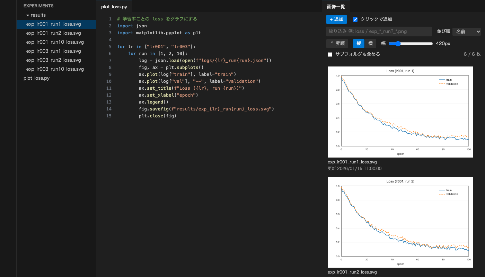
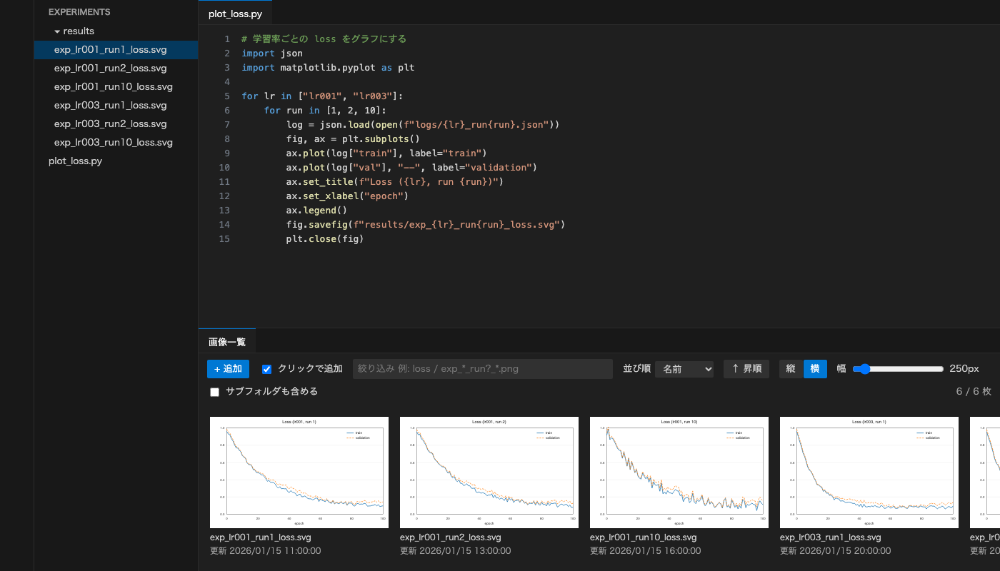

# Image List View

[](https://marketplace.visualstudio.com/items?itemName=fatcorn753.image-list-view) [](https://marketplace.visualstudio.com/items?itemName=fatcorn753.image-list-view)

選んだ画像だけを、VS Code の 1 つのタブに縦または横で並べて表示する拡張機能です。実験結果のグラフを何枚も見比べたいときなどに使えます。

エクスプローラーで画像をクリックするか、ドラッグ&ドロップすると、その画像が一覧に追加されます。



*(画面は説明用の模式図で、グラフは架空のものです)*

[English](README.md) | 日本語

画面の文字は VS Code の表示言語に合わせて、日本語か英語で表示されます。

## 主な機能

- 画像をクリックやドラッグ&ドロップで開くと、1 枚ずつのプレビューではなく一覧に追加される(一覧を開いていなければ自動で開く)
- 縦 1 列、または横 1 行(折り返さず横スクロール)に並べる。枚数の上限はない
- 名前・更新日時・作成日時・サイズで並べ替え(昇順と降順を切り替え可)。名前順は `run2` < `run10` のように数値を数値として比べる
- ファイル名で絞り込み(部分一致、または glob)
- 画像 1 枚の幅を 80〜2000px で調整
- 一覧から外す・外した画像を戻す(ファイル自体は消えない)
- フォルダ内の画像が追加・変更・削除されると自動で更新

## インストール

VS Code の拡張機能ビュー(`Cmd+Shift+X` / `Ctrl+Shift+X`)で「Image List View」を検索してインストールします。[Marketplace のページ](https://marketplace.visualstudio.com/items?itemName=fatcorn753.image-list-view)からも入れられます。

コマンドラインで入れる場合:

```bash
code --install-extension fatcorn753.image-list-view
```

Marketplace を使えない環境では、[Releases](https://github.com/fatcorn753/image-list-view/releases) から `.vsix` をダウンロードし、拡張機能ビューの「…」メニューの「VSIX からのインストール…」で入れてください。

`code` コマンドが見つからないときは、VS Code のコマンドパレット(`Cmd+Shift+P` / `Ctrl+Shift+P`)で「Shell Command: Install 'code' command in PATH」を実行してください(macOS)。

アンインストール:

```bash
code --uninstall-extension fatcorn753.image-list-view
```

## 使い方

1. 左のエクスプローラーで画像をクリックする。普段の 1 枚のプレビューの代わりに画像一覧が開き、その画像が入る。続けてクリックした画像も同じ一覧に足されていく。
2. エクスプローラーから画像をエディタ領域(一覧の上を含む)にドラッグ&ドロップしても同じように入る。複数枚まとめても 1 つの一覧に入る。
3. フォルダごと足すときは、**Shift を押しながら**一覧の上にドロップする(Shift なしだと VS Code がフォルダを一覧に渡さない)。ツールバーの「+ 追加」からも選べる。
4. 一覧の画像にマウスを乗せると右上に「×」が出る。押すと一覧から外れる(ファイルは消えない)。
5. 一覧の中の画像をクリックすると、VS Code 標準のプレビューで横に 1 枚だけ開く。

### 1 枚ずつ普通に開きたいとき

「画像を開くと一覧に入る」動作は、設定 `imageListView.clickToAdd`(既定はオン)で切り替えます。次のどれでも変えられます。

- 一覧のツールバーの「クリックで追加」チェック
- コマンドパレットの「Image List View: クリックで追加のオン・オフを切り替え」
- 設定画面で `imageListView.clickToAdd` を検索

オフのときは、右下のステータスバーに「画像一覧(追加オフ)」と表示されます。

### 分割して使う

一覧はふつうのエディタタブなので、コードの横や下に分割して置けます。分割すると一覧の場所は狭くなるので、ツールバーの「幅」スライダーで画像 1 枚の幅を合わせます。

- 右に分割(上の画像): 「縦」にして、幅を一覧の場所に収まる大きさ(例 420px)にする。コードを見ながら、グラフを上下にスクロールして見比べられる。
- 下に分割(下の画像): 「横」にして、幅を小さく(例 250px)する。何枚ものグラフを 1 行に並べて一度に見比べられる。



タブを右や下に分割するには、一覧のタブをエディタ領域の右端や下端までドラッグするか、タブを右クリックして「右に分割」などを選びます。

### ほかの開き方

- 右下のステータスバーの「画像一覧」を押すと、空の一覧を開く(既にあれば前に出す)。
- エクスプローラーでフォルダや画像(複数選択可)を右クリックして「画像を一覧表示」を選ぶと、それを並べた新しい一覧が開く。
- 一覧が複数あるときは、最後に操作した一覧に画像が入る。
- 既に開いているタブを切り替えただけでは追加されない。

### ツールバー

| 項目 | 内容 |
| --- | --- |
| + 追加 | ファイルやフォルダをダイアログで選んで一覧に足す |
| クリックで追加 | 設定 `imageListView.clickToAdd` のオン・オフ(VS Code 全体に効く) |
| 外した N 枚を戻す | × で外した画像をすべて一覧に戻す(外した画像があるときだけ表示) |
| 絞り込み | ワイルドカードなしなら大文字小文字を無視した部分一致(例 `loss`)。`*` `?` `**` `{a,b}` の glob も使える(例 `exp_*_run{1,2}_*.png`)。`/` を含むとフォルダからの相対パスと照合する |
| 並び順 | 名前・更新日時・作成日時・サイズ。隣のボタンで昇順と降順を切り替える |
| 縦 / 横 | 縦は 1 列、横は折り返さず 1 行に並べる。はみ出した分はスクロールで見る |
| 幅 | 画像 1 枚の幅(80〜2000px) |
| サブフォルダも含める | フォルダを追加したときだけ表示。`.git` と `node_modules` は読まない |

- 並び順・向き・幅などの設定は覚えておき、次に開いたときも同じ状態で始まる(絞り込みの文字だけは引き継がない)。
- 対応形式: png, jpg/jpeg, gif, webp, bmp, svg, ico, avif
- 1 回に読む画像は 5000 枚まで。

## 注意

- 「クリックで追加」がオンの間は、Quick Open など、どの方法で画像を開いても一覧に入ります。1 枚だけ見たいときは、一覧の中の画像をクリックするか、設定をオフにしてください。
- Remote(SSH・WSL・コンテナ)環境での動作は確認していません。

## 開発

依存パッケージもビルド手順もない、素の JavaScript です。

| ファイル | 役割 |
| --- | --- |
| `extension.js` | 拡張本体(パネル管理、フォルダ走査、ファイル監視、クリック追加) |
| `package.nls*.json`, `l10n/` | コマンド名や画面の文字の訳(英語が原文、日本語が訳) |
| `media/logic.js` | 絞り込みと並べ替えの純粋関数(Webview と Node のテストで共用) |
| `media/main.js`, `media/main.css` | 一覧の画面 |
| `test/logic.test.js` | `media/logic.js` の単体テスト |
| `test/integration/index.js` | 実際の VS Code で動かす結合テスト |

単体テスト:

```bash
npm test
```

パッケージ作成(`.vsix` ができる):

```bash
npm run package
```

結合テストは、渡したフォルダにファイルを書き込んでから消すので、使い捨てのフォルダで動かしてください。フォルダの直下に画像を数枚、`sub/` に画像を 1 枚置きます。`--user-data-dir` は短いパスにしてください(長いと IPC ソケットの作成に失敗します)。macOS の例:

```bash
IMAGE_LIST_TEST_DIR=/tmp/ilv-imgs "/Applications/Visual Studio Code.app/Contents/MacOS/Code" --extensionDevelopmentPath=$PWD --extensionTestsPath=$PWD/test/integration/index.js --user-data-dir=/tmp/ilv-ud --extensions-dir=/tmp/ilv-ext /tmp/ilv-imgs
```

## ライセンス

[MIT](LICENSE)
