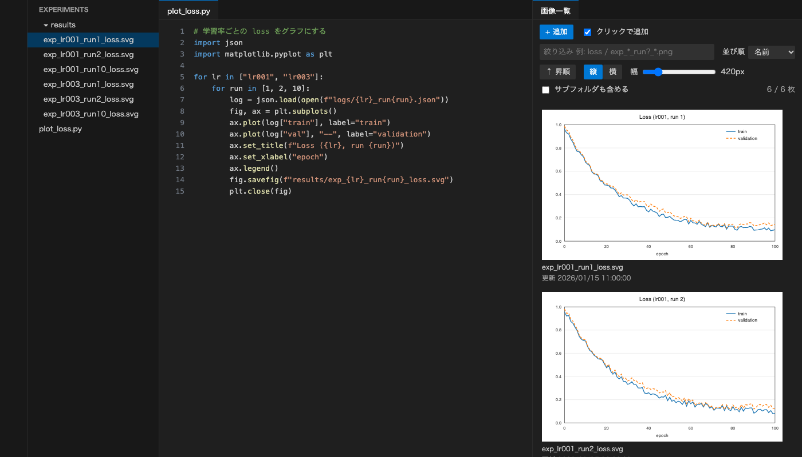
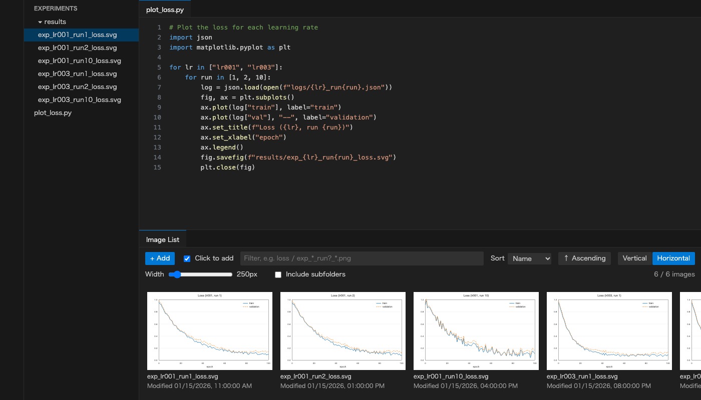

# Image List View

[](https://marketplace.visualstudio.com/items?itemName=fatcorn753.image-list-view) [](https://marketplace.visualstudio.com/items?itemName=fatcorn753.image-list-view)

Show only the images you pick, side by side in a single VS Code tab, vertically or horizontally. Handy for comparing many experiment plots at once.

Click an image in the Explorer, or drag & drop it, and it is added to the list.



*(The screen is an illustration, and the plots are made-up sample data.)*

English | [日本語](README.ja.md)

The UI follows VS Code's display language (English or Japanese).

## Features

- Opening an image by clicking or drag & drop adds it to the list instead of opening a single preview. The list opens automatically if none is open.
- Stack images in one column, or line them up in one row (no wrapping, scroll sideways). No limit on the number of images.
- Sort by name, modified time, created time, or size, ascending or descending. Name sort compares numbers as numbers, so `run2` comes before `run10`.
- Filter by file name (substring or glob).
- Set the width of each image from 80 to 2000 px.
- Remove images from the list and bring them back (the files are never deleted).
- The list updates automatically when images in a folder are added, changed, or deleted.

## Installation

Search for "Image List View" in the Extensions view (`Cmd+Shift+X` / `Ctrl+Shift+X`), or install it from the [Marketplace page](https://marketplace.visualstudio.com/items?itemName=fatcorn753.image-list-view).

From the command line:

```bash
code --install-extension fatcorn753.image-list-view
```

Without Marketplace access, download the `.vsix` from [Releases](https://github.com/fatcorn753/image-list-view/releases) and use "Install from VSIX..." in the "..." menu of the Extensions view.

## Usage

1. Click an image in the Explorer. Instead of the usual single preview, the image list opens with that image in it. Images you click next are added to the same list.
2. Dragging images from the Explorer onto the editor area (including the list) adds them the same way. Dropping several at once puts them all in one list.
3. To add a whole folder, **hold Shift** while dropping it onto the list (without Shift, VS Code does not hand folders to the list). You can also pick it with "+ Add" in the toolbar.
4. Hover an image to show "×" at its top right. Click it to remove the image from the list (the file is not deleted).
5. Click an image in the list to open it alone in VS Code's built-in preview beside the list.

### Opening images one at a time as usual

The setting `imageListView.clickToAdd` (on by default) controls whether opening an image adds it to the list. You can change it with any of these:

- The "Click to add" checkbox in the list toolbar
- "Image List View: Toggle Click to Add" in the Command Palette
- Searching for `imageListView.clickToAdd` in Settings

While it is off, the status bar at the bottom right shows "Image List (adding off)".

### Using it in a split editor

The list is an ordinary editor tab, so you can place it beside or below your code. A split leaves less room for the list, so use the "Width" slider in the toolbar to fit the images.

- Split right (image above): choose "Vertical" and set the width to fit the list area (for example 420 px). Scroll through the plots while you read the code.
- Split down (image below): choose "Horizontal" and make the width small (for example 250 px). Compare many plots in one row at a glance.



To split, drag the list tab to the right or bottom edge of the editor area, or right-click the tab and choose "Split Right" or a similar command.

### Other ways to open the list

- Click "Image List" in the status bar at the bottom right to open an empty list (or bring the existing one to the front).
- Right-click folders or images (multiple selection works) in the Explorer and choose "Show Images in List" to open a new list with them.
- With several lists open, images go to the list you used last.
- Switching to a tab that is already open does not add its image.

### Toolbar

| Item | What it does |
| --- | --- |
| + Add | Pick files or folders in a dialog and add them to the list |
| Click to add | Turns the setting `imageListView.clickToAdd` on or off (applies to all of VS Code) |
| Restore N removed | Puts back every image removed with ×. Shown only when some are removed |
| Filter | Without wildcards: case-insensitive substring match (for example `loss`). Globs with `*` `?` `**` `{a,b}` also work (for example `exp_*_run{1,2}_*.png`). A pattern with `/` is matched against the path relative to the folder |
| Sort | Name, modified, created, or size. The button next to it switches ascending and descending |
| Vertical / Horizontal | Vertical: one column. Horizontal: one row without wrapping. Scroll to see the rest |
| Width | Width of each image (80–2000 px) |
| Include subfolders | Shown only when a folder is in the list. `.git` and `node_modules` are skipped |

- Sort order, layout, width, and other settings are remembered for the next list (the filter text is not carried over).
- Supported formats: png, jpg/jpeg, gif, webp, bmp, svg, ico, avif
- Up to 5000 images are loaded at a time.

## Notes

- While "Click to add" is on, an image opened in any way (Quick Open and so on) goes into the list. To view a single image, click it inside the list or turn the setting off.
- Remote environments (SSH, WSL, containers) are not tested.

## Development

Plain JavaScript with no dependencies and no build step.

| File | Role |
| --- | --- |
| `extension.js` | The extension (panels, folder scanning, file watching, click to add) |
| `package.nls*.json`, `l10n/` | Translations of command names and UI text (English is the source, Japanese is the translation) |
| `media/logic.js` | Pure functions for filtering and sorting (shared by the webview and the Node tests) |
| `media/main.js`, `media/main.css` | The list UI |
| `test/logic.test.js` | Unit tests for `media/logic.js` |
| `test/integration/index.js` | Integration tests that run in a real VS Code |

Unit tests:

```bash
npm test
```

Build a package (creates a `.vsix`):

```bash
npm run package
```

The integration tests write and delete a file in the folder you pass, so use a throwaway folder. Put a few images directly in it and one image in `sub/`. Keep `--user-data-dir` short (a long path makes the IPC socket fail). Example on macOS:

```bash
IMAGE_LIST_TEST_DIR=/tmp/ilv-imgs "/Applications/Visual Studio Code.app/Contents/MacOS/Code" --extensionDevelopmentPath=$PWD --extensionTestsPath=$PWD/test/integration/index.js --user-data-dir=/tmp/ilv-ud --extensions-dir=/tmp/ilv-ext /tmp/ilv-imgs
```

## License

[MIT](LICENSE)
